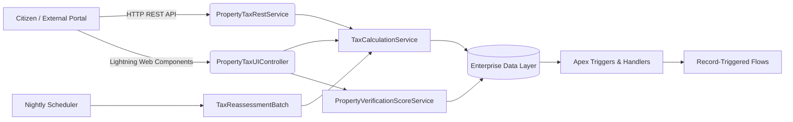
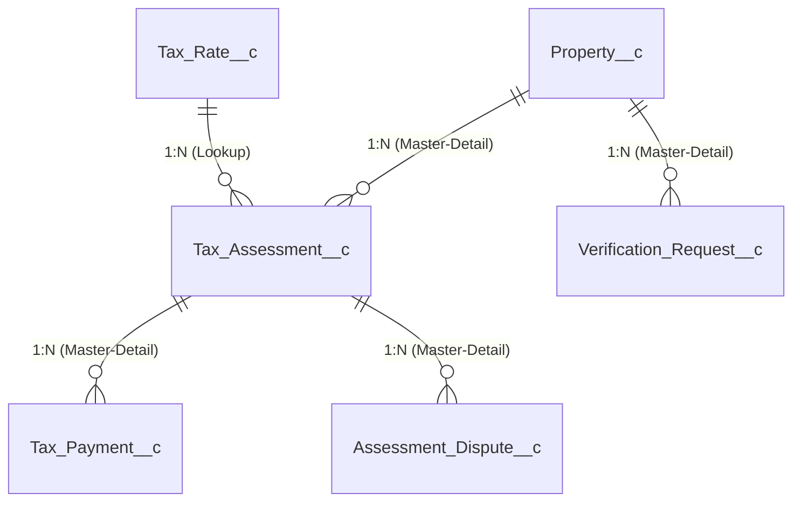

# Smart Property Tax Management System
## Greater Chennai Corporation (GCC)

[](https://salesforce.com)
[](https://developer.salesforce.com)
[](https://developer.salesforce.com)
[](LICENSE)
[](CONTRIBUTING.md)

An enterprise-grade, end-to-end Salesforce DX municipal property tax system designed for the **Greater Chennai Corporation**. This solution digitizes property registration, physical verification prioritization, explainable tax calculations, multi-level approval governance, simulated payment settlement, and real-time executive analytics across Chennai's 15 municipal zones.

---

## 🏛️ Executive Summary & Problem Statement

Property tax is the primary revenue stream funding municipal infrastructure, roads, drainage, and public services in Chennai. However, traditional municipal workflows suffer from three systemic challenges:
1. **Opaque Tax Calculations:** Citizens often dispute tax bills due to complex formulas and unexplainable adjustments.
2. **Unprioritized Verification Queues:** Field survey teams are overwhelmed by arbitrary inspection backlogs without objective risk scoring.
3. **Fragmented Revenue Realization:** Delays in payment reconciliations and lack of zone-wise visibility hinder timely civic budgeting.

The **Smart Property Tax Management System** replaces disparate manual paper trails with an automated, transparent, and auditable Salesforce Lightning architecture.

---

## 🌟 Key Features

### Feature 1: Property Registration & Verification Master
- **Unique Property Identifier:** Enforces standard Chennai municipal format (e.g. `CHN-ZN05-W052-1001`) with automated whitespace trimming and duplicate detection.
- **Structural Classification:** Captures zone, ward, street, property type (Residential/Commercial/Industrial), plinth built-up area in sq ft, number of floors, construction vintage, and occupancy classification.
- **Automated Work Item Queueing:** Trigger automatically spawns an initial `Verification_Request__c` record when a new property is registered.

### Feature 2: Explainable & Configurable Tax Calculation
- **Dynamic Rate Schedule (`Tax_Rate__c`):** Configurable rates per zone, property category, usage, and financial year. Eliminates hardcoded rates in Apex.
- **Transparent Mathematical Engine (`TaxCalculationService.cls`):**
  - **Gross Base Annual Value:** `Built-up Plinth Area (sq ft) × Base Unit Rate (₹/sq ft)`
  - **Self-Occupied Concession:** 10% statutory maintenance rebate for self-occupied homes.
  - **Tamil Nadu Statutory Cesses:**
    - 10% Library Cess under the *Tamil Nadu Public Libraries Act*
    - 5% Municipal Education Surcharge Cess
  - **Auditable Narrative:** Generates an itemized mathematical audit trail stored directly on the assessment record.

### Feature 3: Objective Administrative Priority Scoring
- **0–100 Verification Urgency Index (`PropertyVerificationScoreService.cls`):**
  - Unverified registration: `+25 pts`
  - Incomplete contact/address: `+10 pts each`
  - Commercial or plinth area >= 5,000 sq ft: `+15 pts each`
  - Significant arrears (>= ₹50,000): `+20 pts`
  - Vintage structural age (>= 50 years): `+10 pts`
  - Unresolved discrepancy status: `+30 pts`
- **Tiered Classification:** Low (<30), Medium (30–65), and High (>65) priority.
- **Administrative Aid Disclaimer:** Explicitly documented as an inspection workload optimization tool, not proof of evasion.

### Feature 4: Automated Governance & Separation of Duties
- **Assessment Review Flow:** Proposes assessments with `Submitted` status.
- **Discrepancy Safeguard:** Trigger strictly prevents approving an assessment if the parent property has a flagged inspection discrepancy.
- **Multi-Level Approval:** Enforces separation of duties by auditing approving officer ID and approval timestamp.

### Feature 5: Lightning Web Components (LWC) Suite
- **`propertyRegistrationForm`:** Citizen and officer registration form featuring real-time input validation and instant preliminary tax preview banner.
- **`taxAssessmentCalculator`:** Interactive public calculator computing unit rates, rebates, and cesses on the fly.
- **`propertyTaxSummaryCard`:** Record page component showcasing outstanding dues, assessment status, dispute filing, and payment actions.
- **`verificationPriorityBadge`:** Visual status badge with a one-click modal explaining all scoring factors.
- **`paymentSimulationModal`:** Citizen payment simulator supporting UPI, Net Banking, and municipal counter channels. Generates printable demo tax receipts.
- **`municipalAdminDashboard`:** Executive command center with real-time KPI tiles and zone-wise revenue breakdown tables.

### Feature 6: REST API Integration Service
- `@RestResource(urlMapping='/v1/property-tax/*')`
- `GET /v1/property-tax/properties/{propertyNumber}`: Real-time property and assessment lookup.
- `POST /v1/property-tax/assess`: On-the-fly tax calculation endpoint for external mobile apps.
- `POST /v1/property-tax/payments`: External payment webhook recording `Tax_Payment__c` records with simulation watermarks.

---

## 🏗️ System Architecture



---

## 📊 Data Model & Relationships



| Custom Object | Plural Label | Relationship Model | Key Responsibilities |
| :--- | :--- | :--- | :--- |
| `Property__c` | Properties | Independent (`ReadWrite`) | Property registry, plinth area, zone, ownership, dues rollup |
| `Tax_Rate__c` | Tax Rates | Independent (`ReadWrite`) | Configurable unit rates, cess percentages, rebates |
| `Tax_Assessment__c` | Tax Assessments | Master-Detail (`Property__c`) | Annual assessment value, cesses, approval audit |
| `Tax_Payment__c` | Tax Payments | Master-Detail (`Tax_Assessment__c`) | Transaction receipts, simulated payment tracking |
| `Verification_Request__c`| Verification Requests| Master-Detail (`Property__c`) | Field inspector audit tasks, measured area |
| `Assessment_Dispute__c` | Assessment Disputes | Master-Detail (`Tax_Assessment__c`) | Citizen grievances, hearing scheduling, resolution notes |

---

## 🔒 Security & Access Control

Five tailored Permission Sets enforce least-privilege role boundaries:

1. **`Property_Tax_Citizen`**: Allows residents to register properties, view assessments, settle dues, and file disputes.
2. **`Property_Tax_Verification_Officer`**: Field surveyors measuring plinth areas and updating inspection statuses.
3. **`Property_Tax_Assessor`**: Revenue officers calculating taxes, adjusting rates, and submitting assessments.
4. **`Property_Tax_Zonal_Head`**: Zonal commissioners authorized to approve assessments and resolve disputes.
5. **`Property_Tax_Municipal_Admin`**: Full CRUD, Modify All, batch execution, and rate schedule administration.

---

## 🚀 Installation & Deployment Guide

### 1. Clone Repository & Setup Workspace
```bash
git clone https://github.com/vtu25139-Eswar/Smart-Property-Tax-Management-System-for-Chennai-Municipal-Corporation.git
cd Smart-Property-Tax-Management-System-for-Chennai-Municipal-Corporation
```

### 2. Authenticate Salesforce Developer Edition Org
Authenticate via official browser login:
```bash
sf org login web --alias property-tax-org --set-default
```
Verify the authenticated username:
```bash
sf org display --target-org property-tax-org
# Expected Username: vakanani2006@brave-panda-9mfmin.com
```

### 3. Deploy Metadata
```bash
sf project deploy start --target-org property-tax-org
```

### 4. Assign Permission Set
```bash
sf org assign permset --name Property_Tax_Municipal_Admin --target-org property-tax-org
```

### 5. Seed Demonstration Records
```bash
sf apex run --file scripts/apex/sample-data.apex --target-org property-tax-org
```

---

## 🧪 Testing & Code Quality

Run the complete Apex unit test suite with code coverage:
```bash
sf apex run test --test-level RunLocalTests --target-org property-tax-org --code-coverage --result-format human
```

### Test Coverage Highlights:
- **`TaxCalculationServiceTest`**: 100% logic coverage across rebates, cesses, commercial overrides, and boundary conditions.
- **`PropertyVerificationScoreTest`**: Comprehensive verification of High, Medium, and Low scoring matrices.
- **`PropertyTriggerTest`**: Bulkified testing with 100+ concurrent property inserts and duplicate validation.
- **`TaxAssessmentTriggerTest`**: Validates separation of duties and discrepancy blocking.
- **`TaxPaymentTriggerTest`**: Verifies automated dues settlement and reference generation.
- **`PropertyTaxRestServiceTest`**: Validates REST GET, POST payment, and POST estimation endpoints.

---

## 📑 Documentation Index

- [System Architecture](docs/architecture.md)
- [Data Model & Field Dictionaries](docs/data-model.md)
- [Deployment Guide](docs/deployment-guide.md)
- [Testing & Quality Assurance Guide](docs/testing-guide.md)
- [HR & Technical Interview Demo Script](docs/demo-script.md)

---

## ⚠️ Sandbox Simulation Disclaimer
All payment processing functionalities within this repository simulate transaction settlement using synthetic references (`PAY-CHN-XXXXXX`). **No real banking networks, payment gateways, or monetary transfers are invoked.** All financial rates are illustrative demonstration values for Greater Chennai Corporation educational presentations.

---

## 👥 Authors & Acknowledgments
- **Project Lead & Developer:** Eswar (`vtu25139-Eswar`)
- **Institution:** Vel Tech Rangarajan Dr. Sagunthala R&D Institute of Science and Technology
- **Salesforce Target Org:** `vakanani2006@brave-panda-9mfmin.com`