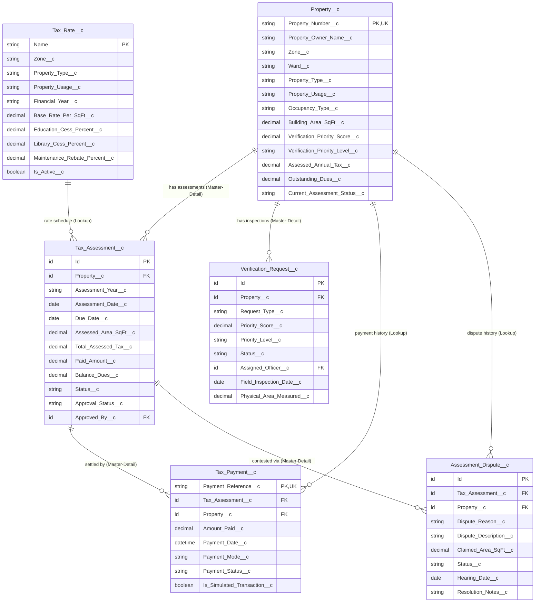

# Data Model: Smart Property Tax Management System
## Greater Chennai Corporation (GCC)

### 1. Entity-Relationship Diagram (ERD)

---

### 2. Custom Object Dictionary

#### A. `Property__c` (Property Master)
| Field API Name | Data Type | Properties | Description |
| :--- | :--- | :--- | :--- |
| `Name` | AutoNumber | `PROP-{YYYY}-{0000}` | Standard system identifier |
| `Property_Number__c` | Text(50) | Unique, External ID, Required | Unique Chennai Municipal Property Assessment Number |
| `Property_Owner_Name__c` | Text(100) | Required | Legal full name of registered titleholder |
| `Owner_Email__c` | Email | - | Electronic communication email address |
| `Owner_Phone__c` | Phone | - | Contact telephone for SMS tax reminders |
| `Property_Address__c` | TextArea | - | Complete postal address with landmarks |
| `Zone__c` | Picklist | Restricted (15 Zones) | Chennai Corporation administrative zone |
| `Ward__c` | Text(30) | - | Municipal ward number (e.g. Ward 114) |
| `Street_Name__c` | Text(100) | - | Locality or street name |
| `Property_Type__c` | Picklist | Residential, Commercial, etc. | High-level property classification |
| `Property_Usage__c` | Picklist | Residential, Apartment, Retail, Office | Specific structural usage |
| `Occupancy_Type__c` | Picklist | Self-Occupied, Tenanted, Vacant | Affects concession / rebate calculation |
| `Building_Area_SqFt__c` | Number(10,2) | Required (> 0) | Built-up plinth area in square feet |
| `Construction_Year__c` | Number(4,0) | - | Baseline construction year |
| `Verification_Status__c` | Picklist | Unverified, Verified, Flagged | Status of physical and documentary audit |
| `Verification_Priority_Score__c` | Number(5,2) | 0 to 100 | Objective verification urgency index |
| `Verification_Priority_Level__c` | Picklist | Low, Medium, High | Operational priority tier |
| `Priority_Score_Reasons__c` | LongTextArea | - | Itemized mathematical audit factors |
| `Assessed_Annual_Tax__c` | Currency(12,2) | - | Most recent annual tax assessment total |
| `Outstanding_Dues__c` | Currency(12,2) | - | Pending unpaid municipal arrears |
| `Current_Assessment_Status__c` | Picklist | Not Assessed, Assessed & Active | Lifecycle status |

---

#### B. `Tax_Rate__c` (Configurable Rate Schedules)
| Field API Name | Data Type | Properties | Description |
| :--- | :--- | :--- | :--- |
| `Name` | Text(80) | Name Field | Rate schedule code (e.g. `RATE-2025-RES-ZN05`) |
| `Zone__c` | Picklist | 15 Zones + All Zones | Geographic scope of rate schedule |
| `Property_Type__c` | Picklist | Residential, Commercial, etc. | Category of property |
| `Property_Usage__c` | Picklist | Specific usage | Structural usage matching |
| `Financial_Year__c` | Picklist | 2024-2025, 2025-2026, etc. | Assessment fiscal year |
| `Base_Rate_Per_SqFt__c` | Currency(10,2) | Required | Unit rate in INR per square foot |
| `Education_Cess_Percent__c` | Percent(5,2) | Default 5.00% | Municipal education surcharge |
| `Library_Cess_Percent__c` | Percent(5,2) | Default 10.00% | TN Public Libraries Act surcharge |
| `Maintenance_Rebate_Percent__c`| Percent(5,2) | Default 10.00% | Concession for self-occupied homes |
| `Penalty_Rate_Percent__c` | Percent(5,2) | Default 2.00% | Late fee interest for arrears |
| `Is_Active__c` | Checkbox | Default True | Controls rate active status |

---

#### C. `Tax_Assessment__c` (Annual Assessment Records)
| Field API Name | Data Type | Properties | Description |
| :--- | :--- | :--- | :--- |
| `Property__c` | Master-Detail | Master-Detail to Property | Parent property record |
| `Assessment_Year__c` | Picklist | Fiscal Year | Financial year being assessed |
| `Assessment_Date__c` | Date | - | Date assessment was computed |
| `Due_Date__c` | Date | Default +60 days | Deadline before late interest applies |
| `Assessed_Area_SqFt__c` | Number(10,2) | - | Built area utilized in computation |
| `Tax_Rate__c` | Lookup | Lookup to Tax_Rate__c | Rate schedule applied |
| `Applied_Base_Rate__c` | Currency(10,2) | - | Rate per sq ft used |
| `Base_Property_Tax__c` | Currency(12,2) | - | Gross base tax (Area × Base Rate) |
| `Rebate_Concession_Amount__c` | Currency(12,2) | - | Concession amount deducted |
| `Education_Cess_Amount__c` | Currency(12,2) | - | Education cess calculated |
| `Library_Cess_Amount__c` | Currency(12,2) | - | Library cess calculated |
| `Penalty_Late_Fee__c` | Currency(12,2) | - | Late payment surcharge |
| `Total_Assessed_Tax__c` | Currency(12,2) | - | Net payable annual tax |
| `Paid_Amount__c` | Currency(12,2) | - | Cumulative settled amount |
| `Balance_Dues__c` | Currency(12,2) | - | Unsettled arrears remaining |
| `Status__c` | Picklist | Draft, Submitted, Approved, Paid | Assessment lifecycle status |
| `Approval_Status__c` | Picklist | Pending, Approved, Rejected | Municipal officer sign-off status |
| `Approved_By__c` | Lookup | Lookup to User | Approving municipal officer |
| `Approval_Date__c` | Date | - | Date of formal approval |
| `Calculation_Explanation__c` | LongTextArea | - | Plain text mathematical audit trail |

---

#### D. `Tax_Payment__c` (Payment & Receipt Master)
| Field API Name | Data Type | Properties | Description |
| :--- | :--- | :--- | :--- |
| `Tax_Assessment__c` | Master-Detail | Master-Detail | Associated tax assessment |
| `Property__c` | Lookup | Lookup | Associated property |
| `Payment_Reference__c` | Text(100) | Unique, External ID | Unique receipt / transaction reference |
| `Amount_Paid__c` | Currency(12,2) | Required (> 0) | Settled amount in INR |
| `Payment_Date__c` | DateTime | Default Now | Transaction timestamp |
| `Payment_Mode__c` | Picklist | UPI, Net Banking, Card, Cash | Payment channel |
| `Payment_Status__c` | Picklist | Initiated, Success, Failed | Transaction outcome |
| `Is_Simulated_Transaction__c` | Checkbox | Default True | **Simulated Sandbox Transaction Flag** |
| `Gateway_Transaction_Id__c` | Text(100) | - | Gateway trace identifier |

---

#### E. `Verification_Request__c` (Field Inspection Work Items)
| Field API Name | Data Type | Properties | Description |
| :--- | :--- | :--- | :--- |
| `Property__c` | Master-Detail | Master-Detail | Target property for inspection |
| `Request_Type__c` | Picklist | Registration, Audit, Discrepancy | Inspection category |
| `Priority_Score__c` | Number(5,2) | Computed | Copied priority urgency score |
| `Priority_Level__c` | Picklist | Low, Medium, High | Operational priority tier |
| `Status__c` | Picklist | Queued, In Progress, Verified | Inspection workflow state |
| `Assigned_Officer__c` | Lookup | Lookup to User | Field surveyor assigned |
| `Physical_Area_Measured__c` | Number(10,2) | - | Area physically measured on site |
| `Area_Discrepancy_Percent__c`| Percent(5,2) | - | Percentage variance vs declared area |

---

#### F. `Assessment_Dispute__c` (Citizen Grievance Master)
| Field API Name | Data Type | Properties | Description |
| :--- | :--- | :--- | :--- |
| `Tax_Assessment__c` | Master-Detail | Master-Detail | Contested assessment record |
| `Property__c` | Lookup | Lookup | Contested property |
| `Dispute_Reason__c` | Picklist | Area, Rate, Concession, Ownership | Formal ground of grievance |
| `Dispute_Description__c` | LongTextArea | Required | Resident's detailed statement |
| `Claimed_Area_SqFt__c` | Number(10,2) | - | Correct area asserted by resident |
| `Status__c` | Picklist | Filed, In Review, Hearing, Resolved | Grievance resolution stage |
| `Hearing_Date__c` | Date | - | Date of municipal grievance hearing |
| `Resolution_Notes__c` | LongTextArea | - | Hearing officer findings and order |
